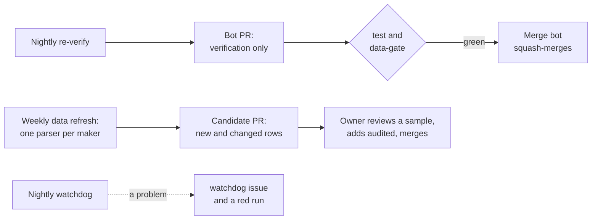

# Patchlife

**The best-before date for your smart devices.**

[](https://github.com/sombreserotonin/Patchlife/actions/workflows/ci.yml)
[](LICENSE)
[](data/LICENSE)

Smart devices stop getting security updates long before they stop working, and buyers rarely know when. Patchlife looks up when a camera, doorbell, router, printer or smart plug stops getting security updates, and quotes the manufacturer's own words as evidence.

Each answer reads like this (a fictional example):

> Security updates until at least 30 June 2029, as published by Acme (checked 2 Oct 2026).

One person runs Patchlife. Scripts on GitHub Actions re-check every quote against the maker's page and propose new rows, and the owner reviews each batch before it is published. Patchlife was built in 2026 with Claude Code, an AI coding tool, which no longer runs any part of it.

## Contents
- [Why](#why)
- [Status](#status)
- [How it works](#how-it-works)
- [Getting started](#getting-started)
- [How the project runs](#how-the-project-runs)
- [Corrections and contributions](#corrections-and-contributions)
- [Repository layout](#repository-layout)
- [Documentation](#documentation)
- [Licence](#licence)

## Why
- **Makers must now publish it.** Australia's smart device rules apply to most household smart devices made from 4 March 2026, and makers must publish how long a device gets security updates ([Home Affairs](https://www.homeaffairs.gov.au/about-us/our-portfolios/cyber-security/security-standards-for-smart-devices)). The UK has required a statement of compliance since 29 April 2024 under the PSTI regulations ([Cooley](https://www.cooley.com/services/practice/european-tech-regulation/products/uk-product-security-and-telecommunications-infrastructure-act)).
- **But it's scattered.** The information sits in thousands of separate support pages and PDFs, often as a rule ("3 years after end of life") rather than a date.
- **And often missing.** US FTC staff found that 163 of 184 smart products (88.6%) gave no support duration or end date on the product page ([FTC, 2024](https://www.ftc.gov/system/files/ftc_gov/pdf/smart-device-makers-failure-to-provide-software-updates-may-leave-you-smarting.pdf)).

Patchlife collects those statements in one place, with a quote and a link for every date. The full case is in [`docs/BRIEF.md`](docs/BRIEF.md).

## Status
As of 13 November 2026:
- **Live:** https://patchlife.tech, with 849 verified records from seven makers (Ring, Google Nest, TP-Link, EZVIZ, GL.iNet, Kyocera and ASUS), each quoting the maker's own page.
- **Unattended:** every quote is re-checked on a schedule, new and changed rows arrive as one pull request a week, and a watchdog reports problems, all on GitHub Actions with no AI and no subscription ([`docs/OPERATIONS.md`](docs/OPERATIONS.md)).
- **Maintenance mode:** new makers are added by hand ([`docs/RUNBOOKS.md`](docs/RUNBOOKS.md), O11), and the business side is shelved (D45).

| Milestone | Goal | State |
| --- | --- | --- |
| M0 Foundation | CI green, labels, human gates opened | Done |
| M1 Evidence engine | Automated quote checking and 50 verified camera and doorbell records | Done |
| M2 Public site | Search-only static site and JSON feed | Done |
| M3 Unattended data | Scheduled re-verification and data refresh | Done |
| M4 Demand check | Four weeks of search data and a waitlist for business users | Planned, not active (D45) |
| M5 Search links | A `?q=` link opens the matching records (no browser extension, D46) | Done |
| M6 B2B | CSV reports, paid API keys, supplier SKU checks | Planned, not active (D45) |
| M7 Growth | Atom feeds and a monthly stats page (no email alerts, D46) | Done |

[`docs/PLAN.md`](docs/PLAN.md) has the October 2026 plan, the owner's decisions and the Measures. [`docs/MIGRATION.md`](docs/MIGRATION.md) is how the project moved off AI sessions and subscriptions, finished on 13 November 2026; the task list, roadmap and log from that period are frozen in [`.agent/`](.agent/).

## How it works

### Evidence first
Every support date comes from the manufacturer, never from inference:
- Each record cites a primary source URL and a short verbatim quote (300 characters at most) that states the date or rule.
- Sources are ranked: the manufacturer's statement of compliance or security support page first, then its end-of-life pages, then a regulator registry. News, forums, retailers and AI answers are leads only.
- A rule such as "3 years after end of life" stays a rule until the maker publishes the end-of-life date. Nothing is estimated.
- If a real search finds nothing, the record says so (`none_published`).

The rules are in [`docs/DATA-POLICY.md`](docs/DATA-POLICY.md).

### One file per model
Records live in git as YAML, one file per model at `data/devices/<brand_slug>/<id>.yaml`, checked against [`data/schema/device.schema.json`](data/schema/device.schema.json). A fictional example:

```yaml
id: acme-cam-1
brand: Acme
brand_slug: acme
model: Cam 1
aliases: [AC-1]
category: camera
regions: [AU, UK]
support:
  rule: fixed_date
  end_date: "2029-06-30"
  at_least: true
evidence:
  - url: https://example.com/acme/security
    quote: Acme Cam 1 30 June 2029
    retrieved: "2026-10-01"
    regime: au_smart_device_rules
verification:
  status: verified
  checked: "2026-10-02"
```

| `support.rule` | Meaning |
| --- | --- |
| `fixed_date` | The source gives an end date |
| `years_after_eol` | N years after the maker ends sales or declares end of life |
| `years_after_launch` | N years after launch or first availability |
| `years_after_manufacture` | N years after manufacture (varies by batch) |
| `years_after_purchase` | N years after the buyer's purchase |
| `none_published` | Searched and found nothing |

### Automated quote checking
`npm run verify:evidence` fetches every evidence URL, extracts the page text, normalises it (Unicode NFKC, collapsed whitespace, case-insensitive) and checks the quote is still there:
- **Quote found:** the record is marked `verified`, with the date checked and a SHA-256 hash of the page text.
- **Quote gone from a verified record:** the record is marked `stale` so it gets new evidence.
- **Page unreachable:** the record is left unchanged and the run reports it.

It also keeps one SHA-256 hash per evidence URL, of that page's normalised text, in `data/sources/page-hashes.json`, and reports each page it read as changed, unchanged or not seen before. Most records cite more than one page and many records share a page, so this shows which page changed.

Only quotes and hashes are stored, never whole pages. The fetcher identifies itself as PatchlifeBot, honours `robots.txt`, and makes at most one request per second per host ([`docs/CRAWLER.md`](docs/CRAWLER.md)). It reads HTML, plain text and PDF; PDF text comes from pdf.js through `unpdf`. The nightly run also asks the Wayback Machine to capture cited pages, and links a capture only when it holds the quote.

### Support status
Status is worked out from the dates each time the site is built, and never stored in a record:

| Status | Meaning |
| --- | --- |
| `supported` | More than 12 months of updates left |
| `ending_soon` | 12 months or less left, up to and including the end date |
| `ended` | The end date has passed |
| `unknown` | No date can be worked out, such as a rule whose anchor date isn't published |

## Getting started
You need Node.js 22.21 or later (`npm run verify:evidence` uses Node's `--use-env-proxy` flag). The workflows run on Node 26.

```sh
git clone https://github.com/sombreserotonin/Patchlife.git
cd Patchlife
npm ci
```

| Command | What it does |
| --- | --- |
| `npm run validate` | Checks every record against the schema and integrity rules |
| `npm test` | Runs the unit tests offline against saved fixtures; no test touches the network |
| `npm run verify:evidence [-- <id> ...]` | Fetches evidence URLs, marks records `verified` or `stale`, and updates the page hashes in `data/sources/page-hashes.json`. Reads makers' pages |
| `npm run build:site` | Builds the static site into `_site/`. `BASE_PATH`, `SITE_URL`, `BUILD_DATE` and `NOINDEX` set the base path, origin, status date and preview mode. Run `npm run validate` first |
| `node scripts/data-report.mjs` | Prints the Measures rows of `docs/PLAN.md`, then counts by brand, category, status and verification state. Reads only local files |
| `node scripts/verification-only.mjs [ref]` | Exits 0 only if, under `data/`, the working tree differs from `ref` (default `HEAD`) in nothing but device records' `verification` blocks, empty `archive_url` fields filled with a capture of their own page, and `data/sources/page-hashes.json`: the test for a re-verification that may merge without an audit |
| `node scripts/archive-evidence.mjs [--limit <n>] [url ...]` | Asks the Wayback Machine to capture each cited page (or the ones named) that has an item with no `archive_url`, and links each item whose quote the capture's raw copy holds. It runs in the nightly re-verify workflow (D43); always exits 0 |
| `node scripts/merge-bot.mjs [--dry-run]` | Merges only the routine PRs the bot opens (re-verify and measures), at the exact commit it checked, once `test`, `data-gate` and `build` pass and every file fits the PR's type; anything else waits for the owner (D47). Env: `GH_TOKEN`, `GITHUB_REPOSITORY`, `BOT_LOGIN` (the App's login, ending `[bot]`) |
| `node scripts/check-licences.mjs [lockfile]` | Exits 1 if any package in `package-lock.json` has a missing licence or one D9 and D30 don't allow |
| `node scripts/watchdog.mjs [--dry-run] [--summary]` | The alarm: checks workflows, run ages, re-verify branches, unchecked and stale records, `needs-human` age, the live site's status date and `ops/renewals.yml`, then keeps one `watchdog` issue up to date and exits 1 on any problem; `--summary` posts the weekly summary on #27, `--dry-run` writes nothing. Env: `GH_TOKEN`, `GITHUB_REPOSITORY` |
| `node scripts/unquoted-dates.mjs [url ...]` | Lists each date on the cited pages (or the ones named) that no record's quote covers: rows we don't have yet, or prose. Reads makers' pages; always exits 0 |
| `node scripts/page-text.mjs [--grep <text>] <url>` | Prints the final URL and content type, then the page text exactly as the verifier sees it, folded at 300 characters, so quotes are copied from it (RUNBOOKS O11 step 3); `--grep` prints only the numbered lines holding the text. Exits 1 when the page can't be read |
| `node scripts/check-source.mjs <url>` | The RUNBOOKS O11 step 2 triage of a source page: robots.txt verdict, HTTP status and content type, whether dates are in the raw response, how many the page text holds and up to 5 rows around them. Exits 0 when the page can be used as evidence and 1 with the reason when it can't |
| `node scripts/audit-sample.mjs <pr number> [id ...]` | Picks the records to spot-check before merging a data PR: 3 or 5% of the ids, at most 10, ranked by a hash seeded with the PR number so the same PR always gives the same sample; with no ids, the records changed since the branch left main. Prints id, model, end date and the cited page with the quote highlighted. Reads only local files |
| `node scripts/repoint-source.mjs <old url> <new url> [--dry-run]` | Moves every evidence item citing the old URL to the new one, keeping quotes and clearing `archive_url`, then re-verifies the touched records with the verifier; `--dry-run` lists them without fetching. Exits 1 listing any record that did not verify |
| `node scripts/candidates.mjs [--check] [--limit <n>] [--report <file>] [brand ...]` | Runs each brand's parser (`scripts/parsers/`, default: every brand with one) on its profiled pages and matches the candidate records to the existing ones by row quote, never by id. `--check` writes nothing and reports per page: rows found, records reproduced, fields that differ, changed rows, new rows and id mismatches; without it, a record whose row changed is rewritten from the parser's row (its row-derived fields and evidence, verification restarted, never a `parser_exceptions` record), then the new rows become unverified records under `data/devices/`, changed rows first and new rows one brand at a time, up to `--limit` (default 60; MIGRATION decision 5). `--report` writes a JSON report (the pages' counts, the records written with before and after, and the flags for a person: conflicts, ambiguous rows, unquotable candidates, changed exceptions). Exits 1 when the parser fails to reproduce a record (MIGRATION's parser gate) or a page has fewer rows than the profile's `min_rows`. Reads makers' pages |
| `scripts/parsers/` | Not commands: one parser per brand. `tp-link-au.mjs` and `ezviz-eol.mjs` read one table each; `ring.mjs` merges the GB, AU and US pages (a model with different dates on different pages is a D33 split, reported and never written), `google.mjs` reads the Nest table's release date, end date and Yes/No cell and adds the UK and Australian statements the profile's renames table links, `gl-inet.mjs` reads the PSTI minimums and the firmware table's Maintenance rows (a model on both pages is a D39 case, reported), `kyocera.mjs` reads the bold model and list blocks, and `asus.mjs` splits each group row's models on the markup and quotes from the model to the date |
| `scripts/table-rows.mjs` | Not a command: the cell-based table reader the parsers use. Splits rows and cells on the raw HTML, keeps `<sup>` footnote markers beside the cell text, and gives each row's quote as its cell texts joined by single spaces |

## How the project runs
GitHub Actions does the routine work, and one person reviews it. No AI is in the loop.



- **Re-verification.** Every night a workflow re-checks the records that are due, as `patchlife-bot`, and opens a pull request that changes nothing but verification results. The merge bot merges only that kind of PR, and the monthly measures.
- **Weekly refresh.** Each maker with a parser has a profile in [`data/sources/seed.yaml`](data/sources/seed.yaml). The parsers must first reproduce every existing record; then changed rows and new rows are proposed as one candidate PR.
- **The gate.** A PR that changes data beyond a re-verification merges only with the owner's own `audited` label, which every push removes. The check is judged with the base branch's scripts.
- **Protected files.** CI labels any PR that changes the workflows, the rules, the dependency files, the bot's scripts, the source registry or the schemas with `needs-human-merge`, and only the owner merges it.
- **The watchdog.** Each night it checks the workflows, the site, stale and unchecked records and anything waiting on the owner, keeps one `watchdog` issue, and turns its run red on a problem. On Sundays it posts a summary with five random records to spot-check.
- **By hand.** The `Owner tools` workflow reads or triages a page, re-verifies records, moves records to a page that moved, or pulls a wrong date, all on a GitHub runner.

`main` needs a pull request and passing `test` and `data-gate` checks, and force pushes and deletion are blocked. The procedures are in [`docs/RUNBOOKS.md`](docs/RUNBOOKS.md), the rules for changing the repository in [`CONTRIBUTING.md`](CONTRIBUTING.md), and the security model in [`docs/ARCHITECTURE.md`](docs/ARCHITECTURE.md).

## Corrections and contributions
- **Wrong or outdated date?** Use the [Wrong or outdated date](https://github.com/sombreserotonin/Patchlife/issues/new/choose) form and link the manufacturer's own page. A fix always comes from a primary source, never from the report itself.
- **Device missing?** Use the Add a device form on the same page.
- **Site owners:** [`docs/CRAWLER.md`](docs/CRAWLER.md) explains what PatchlifeBot fetches and how to opt out.
- **Code and data contributions** are not accepted until a contributor licence agreement is in place.

Patchlife doesn't publish reviews, ratings or brand rankings without a published methodology, give legal advice, certify compliance, or scrape retailer prices or reviews.

## Repository layout
| Path | What |
| --- | --- |
| [`data/devices/`](data/devices/) | Device records, one YAML file per model |
| [`data/schema/`](data/schema/) | JSON Schemas for a device record and a source registry file |
| [`data/sources/`](data/sources/) | The source registry (starting URLs and each parsed maker's profile) and the page hashes |
| [`scripts/`](scripts/) | Validator, status computation, verifier and polite fetcher, site builder, parsers, merge bot and watchdog |
| [`site/`](site/) | The site's search script |
| [`tests/`](tests/) | Unit tests and saved fixtures |
| [`docs/`](docs/) | Operations, runbooks, decisions, data policy, spec, architecture, brief, plan, migration, crawler page |
| [`ops/`](ops/) | `renewals.yml`: what must be renewed, and when |
| [`.github/`](.github/) | The workflows, Dependabot settings, issue forms and PR template |
| [`CONTRIBUTING.md`](CONTRIBUTING.md) | The commands and the rules for changing this repository |
| [`CLAUDE.md`](CLAUDE.md) | A pointer to `CONTRIBUTING.md` for any AI tool asked to work here |
| [`.agent/`](.agent/) | Frozen history from the period when AI sessions ran the project: tasks, roadmap, log and session notes |

## Documentation
| Document | Covers |
| --- | --- |
| [`docs/OPERATIONS.md`](docs/OPERATIONS.md) | How it runs: what runs when, settings, alerts, backups, rollback |
| [`docs/RUNBOOKS.md`](docs/RUNBOOKS.md) | Step-by-step procedures for the owner |
| [`docs/DATA-POLICY.md`](docs/DATA-POLICY.md) | Evidence, quoting, accuracy and crawling rules |
| [`docs/DECISIONS.md`](docs/DECISIONS.md) | Durable decisions, one line each |
| [`docs/SPEC.md`](docs/SPEC.md) | What gets built: records, status, verifier, site |
| [`docs/ARCHITECTURE.md`](docs/ARCHITECTURE.md) | How it is built and run, and the security model |
| [`docs/BRIEF.md`](docs/BRIEF.md) | The problem, users, revenue and risks |
| [`docs/PLAN.md`](docs/PLAN.md) | The October 2026 plan: milestones, the owner's decisions, risks and the Measures |
| [`docs/MEASURES.md`](docs/MEASURES.md) | The monthly counts, regenerated by a workflow |
| [`docs/MIGRATION.md`](docs/MIGRATION.md) | How the project moved off AI and subscriptions (D44), finished 13 Nov 2026 |
| [`docs/COSTS.md`](docs/COSTS.md) | The cost research behind the migration (history) |
| [`docs/CRAWLER.md`](docs/CRAWLER.md) | PatchlifeBot, for site owners |

## Licence
- **Code:** GNU Affero General Public License v3.0 or later ([`LICENSE`](LICENSE)).
- **Data** in `data/`: Open Database License v1.0 ([`data/LICENSE`](data/LICENSE)). Attribute it as "Contains data from Patchlife, available under the Open Database License." Scope and attribution details are in [`data/NOTICE.md`](data/NOTICE.md).
- Quoted manufacturer statements remain their owners' property and are included only as evidence.
