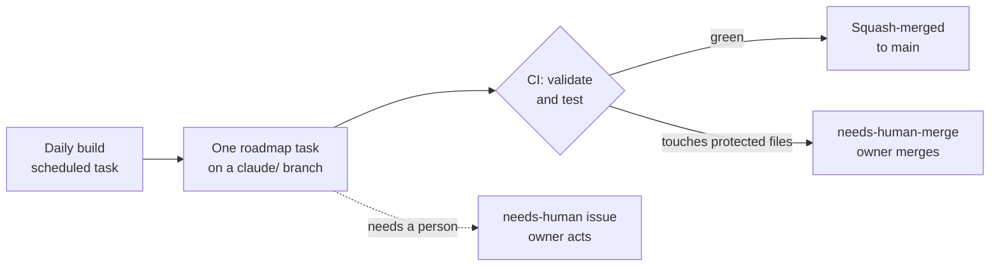

# Patchlife

**The best-before date for your smart devices.**

[](https://github.com/sombreserotonin/Patchlife/actions/workflows/ci.yml)
[](LICENSE)
[](data/LICENSE)

Smart devices stop getting security updates long before they stop working, and buyers rarely know when. Patchlife looks up when a camera, doorbell, router, printer or smart plug stops getting security updates, and quotes the manufacturer's own words as evidence.

Each answer reads like this (a fictional example):

> Security updates until at least 30 June 2029, as published by Acme (checked 2 Oct 2026).

Claude Code builds and runs the project end to end. A human owner handles the gates that need a person: money, accounts, secrets, legal text, publishing, and merging changes to protected files.

## Contents
- [Why](#why)
- [Status](#status)
- [How it works](#how-it-works)
- [Getting started](#getting-started)
- [How the project runs itself](#how-the-project-runs-itself)
- [Corrections and contributions](#corrections-and-contributions)
- [Repository layout](#repository-layout)
- [Documentation](#documentation)
- [Licence](#licence)

## Why
- **Makers must now publish it.** Australia's smart device rules apply to most household smart devices made from 4 March 2026, and makers must publish how long a device gets security updates ([Home Affairs](https://www.homeaffairs.gov.au/about-us/our-portfolios/cyber-security/security-standards-for-smart-devices)). The UK has required a statement of compliance since 29 April 2024 under the PSTI regulations ([Cooley](https://www.cooley.com/services/practice/european-tech-regulation/products/uk-product-security-and-telecommunications-infrastructure-act)).
- **But it's scattered.** The information sits in thousands of separate support pages and PDFs, often as a rule ("3 years after end of life") rather than a date.
- **And often missing.** US FTC staff found that 163 of 184 smart products (88.6%) gave no support duration or end date on the product page ([FTC, 2024](https://www.ftc.gov/system/files/ftc_gov/pdf/smart-device-makers-failure-to-provide-software-updates-may-leave-you-smarting.pdf)).

Patchlife collects those statements in one place, with a quote and a link for every date. The full case is in [`docs/BRIEF.md`](docs/BRIEF.md).

## Status
As of 21 October 2026:
- **Done:** M0, the foundation; M1, the evidence engine and the first records (338 audited, verified records from Ring, Google Nest, TP-Link, EZVIZ and GL.iNet); M2, the site.
- **In progress:** M3, unattended data: the nightly data task, re-verification, PDF sources, and 40 or more small-office records.
- **Site:** a preview is live at https://sombreserotonin.github.io/Patchlife/ (not indexed by search engines). It moves to patchlife.tech after the owner's legal read.

[`docs/PLAN.md`](docs/PLAN.md) has the plan, the decisions and the 14-day action plan; [`docs/COSTS.md`](docs/COSTS.md) has the plan for moving off subscription AI. Live progress is in [`.agent/progress/TASKS.md`](.agent/progress/TASKS.md), and the exit checks for each milestone are in [`.agent/progress/ROADMAP.md`](.agent/progress/ROADMAP.md).

| Milestone | Goal |
| --- | --- |
| M0 Foundation | CI green, labels, human gates opened |
| M1 Evidence engine | Automated quote checking and 50 verified camera and doorbell records |
| M2 Public site | Search-only static site and JSON feed |
| M3 Unattended data | Nightly data refresh and a 90-day re-check |
| M4 Demand check | Four weeks of search data and a waitlist for business users |
| M5 Browser extension | Support status badges on three retailers' product pages |
| M6 B2B | CSV reports, paid API keys, supplier SKU checks |
| M7 Growth | Monthly report and email alerts |

## How it works

### Evidence first
Every support date comes from the manufacturer, never from inference:
- Each record cites a primary source URL and a short verbatim quote (300 characters at most) that states the date or rule.
- Sources are ranked: the manufacturer's statement of compliance or security support page first, then its end-of-life pages, then a regulator registry. News, forums, retailers and AI answers are leads only.
- A rule such as "3 years after end of life" stays a rule until the maker publishes the end-of-life date. Nothing is estimated.
- If a real search finds nothing, the record says so (`none_published`).

The rules are in [`docs/DATA-POLICY.md`](docs/DATA-POLICY.md).

### One file per model
Records live in git as YAML, one file per model at `data/devices/<brand_slug>/<id>.yaml`, checked against [`data/schema/device.schema.json`](data/schema/device.schema.json). A fictional example:

```yaml
id: acme-cam-1
brand: Acme
brand_slug: acme
model: Cam 1
aliases: [AC-1]
category: camera
regions: [AU, UK]
support:
  rule: fixed_date
  end_date: "2029-06-30"
  at_least: true
evidence:
  - url: https://example.com/acme/security
    quote: Acme Cam 1 30 June 2029
    retrieved: "2026-10-01"
    regime: au_smart_device_rules
verification:
  status: verified
  checked: "2026-10-02"
```

| `support.rule` | Meaning |
| --- | --- |
| `fixed_date` | The source gives an end date |
| `years_after_eol` | N years after the maker ends sales or declares end of life |
| `years_after_launch` | N years after launch or first availability |
| `years_after_manufacture` | N years after manufacture (varies by batch) |
| `years_after_purchase` | N years after the buyer's purchase |
| `none_published` | Searched and found nothing |

### Automated quote checking
`npm run verify:evidence` fetches every evidence URL, extracts the page text, normalises it (Unicode NFKC, collapsed whitespace, case-insensitive) and checks the quote is still there:
- **Quote found:** the record is marked `verified`, with the date checked and a SHA-256 hash of the page text.
- **Quote gone from a verified record:** the record is marked `stale` so it gets new evidence.
- **Page unreachable:** the record is left unchanged and the run reports it.

It also keeps one SHA-256 hash per evidence URL, of that page's normalised text, in `data/sources/page-hashes.json`, and reports each page it read as changed, unchanged or not seen before. Most records cite more than one page and many records share a page, so this shows which page changed.

Only quotes and hashes are stored, never whole pages. The fetcher identifies itself as PatchlifeBot, honours `robots.txt`, and makes at most one request per second per host ([`docs/CRAWLER.md`](docs/CRAWLER.md)). It reads HTML, plain text and PDF; PDF text comes from pdf.js through `unpdf`. Archive snapshots are not supported yet.

### Support status
Status is worked out from the dates each time the site is built, and never stored in a record:

| Status | Meaning |
| --- | --- |
| `supported` | More than 12 months of updates left |
| `ending_soon` | 12 months or less left, up to and including the end date |
| `ended` | The end date has passed |
| `unknown` | No date can be worked out, such as a rule whose anchor date isn't published |

## Getting started
You need Node.js 22 or later. `npm run verify:evidence` needs Node.js 22.21 or later, because it uses Node's `--use-env-proxy` flag.

```sh
git clone https://github.com/sombreserotonin/Patchlife.git
cd Patchlife
npm ci
```

| Command | What it does |
| --- | --- |
| `npm run validate` | Checks every record against the schema and integrity rules |
| `npm test` | Runs the unit tests offline against saved fixtures; no test touches the network |
| `npm run verify:evidence [-- <id> ...]` | Fetches evidence URLs, marks records `verified` or `stale`, and updates the page hashes in `data/sources/page-hashes.json`. Needs network access to manufacturer sites, so in cloud sessions it runs in the `Crawl` environment |
| `npm run build:site` | Builds the static site into `_site/`. `BASE_PATH`, `SITE_URL`, `BUILD_DATE` and `NOINDEX` set the base path, origin, status date and preview mode. Run `npm run validate` first |
| `node scripts/data-report.mjs` | Prints the Measures rows of `docs/PLAN.md`, then counts by brand, category, status and verification state. Reads only local files, so it runs in any environment |

## How the project runs itself
Claude Code does the work in cloud sessions and scheduled tasks. The guard rails are in the repository itself:



- **Daily build.** A scheduled task runs every morning at 06:08 Sydney time with the prompt in [`.agent/prompts/daily-build.md`](.agent/prompts/daily-build.md). It merges green agent PRs, does one roadmap task, and opens a PR.
- **Two environments.** Code, tests and docs happen in the `Default` cloud environment, whose network cannot reach manufacturer sites. Everything that reads a manufacturer page, from adding records to `npm run verify:evidence`, runs in the `Crawl` environment, whose network allowlist adds a fixed list of manufacturer hosts (see [`docs/ARCHITECTURE.md`](docs/ARCHITECTURE.md)). Step-by-step procedures are in [`docs/RUNBOOKS.md`](docs/RUNBOOKS.md).
- **Branch protection.** `main` needs a pull request and a passing `test` check, and force pushes and deletion are blocked.
- **Protected files.** CI labels any PR from a branch in this repository that changes `.github/`, `.claude/`, `.agent/prompts/`, `CLAUDE.md`, `package.json` or `package-lock.json` with `needs-human-merge`, and agents leave those PRs for the owner to merge. This is a project rule, not a GitHub permission: agents act with the owner's GitHub identity (see the security model in [`docs/ARCHITECTURE.md`](docs/ARCHITECTURE.md)).
- **Human gates.** Anything that needs a person (money, accounts, secrets, DNS, legal text, publishing) becomes a `needs-human` issue with exact steps.
- **Memory.** Agents start every session from [`CLAUDE.md`](CLAUDE.md) and the files in [`.agent/`](.agent/): durable decisions, current context, the roadmap, an append-only log and a note per session.

## Corrections and contributions
- **Wrong or outdated date?** Use the [Wrong or outdated date](https://github.com/sombreserotonin/Patchlife/issues/new/choose) form and link the manufacturer's own page. A fix always comes from a primary source, never from the report itself.
- **Device missing?** Use the Add a device form on the same page.
- **Site owners:** [`docs/CRAWLER.md`](docs/CRAWLER.md) explains what PatchlifeBot fetches and how to opt out.
- **Code and data contributions** are not accepted until a contributor licence agreement is in place.

Patchlife doesn't publish reviews, ratings or brand rankings without a published methodology, give legal advice, certify compliance, or scrape retailer prices or reviews.

## Repository layout
| Path | What |
| --- | --- |
| [`data/devices/`](data/devices/) | Device records, one YAML file per model |
| [`data/schema/`](data/schema/) | JSON Schemas for a device record and a source registry file |
| [`data/sources/`](data/sources/) | Starting URLs per brand (leads, not evidence) |
| [`scripts/`](scripts/) | Validator, status computation, evidence checker and polite fetcher |
| [`tests/`](tests/) | Unit tests and saved fixtures |
| [`docs/`](docs/) | Plan, costs, runbooks, brief, spec, architecture, data policy, crawler page |
| [`.agent/`](.agent/) | Agent memory, roadmap, tasks, log, session notes and scheduled-task prompts |
| [`.claude/`](.claude/) | Claude Code permissions and the `add-device-record` skill |
| [`.github/`](.github/) | CI, the optional Claude workflow, issue forms and PR template |
| [`CLAUDE.md`](CLAUDE.md) | Agent rules and read order, loaded every session |
| [`KICKOFF.md`](KICKOFF.md) | The prompt that started the project |

## Documentation
| Document | Covers |
| --- | --- |
| [`docs/PLAN.md`](docs/PLAN.md) | Where the project is going: milestones, decisions, risks and the action plan |
| [`docs/COSTS.md`](docs/COSTS.md) | What the automation costs, and the staged plan to move off subscription AI |
| [`docs/RUNBOOKS.md`](docs/RUNBOOKS.md) | Step-by-step procedures for the owner and agent sessions |
| [`docs/BRIEF.md`](docs/BRIEF.md) | The problem, users, revenue and risks |
| [`docs/SPEC.md`](docs/SPEC.md) | What gets built: records, status, verifier, site, extension, B2B |
| [`docs/ARCHITECTURE.md`](docs/ARCHITECTURE.md) | How it is built and run, and the security model |
| [`docs/DATA-POLICY.md`](docs/DATA-POLICY.md) | Evidence, quoting, accuracy and crawling rules |
| [`docs/CRAWLER.md`](docs/CRAWLER.md) | PatchlifeBot, for site owners |

## Licence
- **Code:** GNU Affero General Public License v3.0 or later ([`LICENSE`](LICENSE)).
- **Data** in `data/`: Open Database License v1.0 ([`data/LICENSE`](data/LICENSE)). Attribute it as "Contains data from Patchlife, available under the Open Database License." Scope and attribution details are in [`data/NOTICE.md`](data/NOTICE.md).
- Quoted manufacturer statements remain their owners' property and are included only as evidence.
